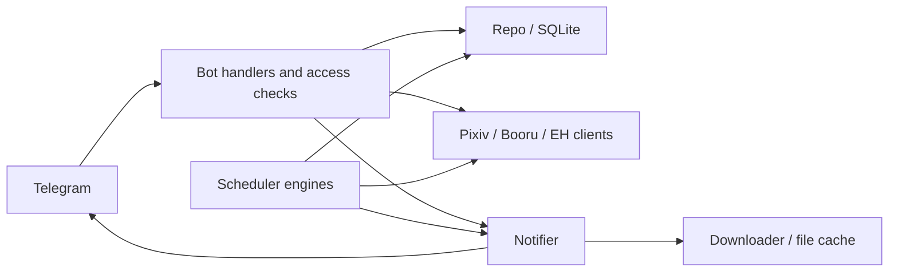
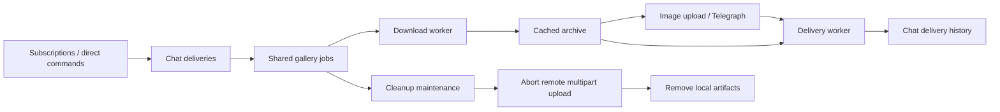

# Architecture

`src/main.rs` loads configuration, runs database migrations, constructs shared clients, and starts the Telegram bot and scheduler workers.

| Module | Responsibility |
| --- | --- |
| `src/bot` | Commands, access checks, settings dialogues, callbacks, and Telegram delivery |
| `src/scheduler` | Polling, subscription filters, delivery queues, and retry decisions |
| `src/db` | Entities, persisted state, and transactional Repo operations |
| `migration` | Ordered schema and data migrations, applied at startup |
| `pixiv_client`, `booru_client`, `eh_client` | Service protocols, authentication, parsing, and transport |
| `src/pixiv`, `src/booru`, `src/cache` | Application client wiring, downloads, and cached files |

## Pixiv and Booru subscriptions

Pixiv author subscriptions track new works per author. Tag subscriptions share a search cursor by query and queue works that reach each subscription's bookmark threshold. Search dates use Japan Standard Time; the date, offset, and last publication timestamp are checkpointed together. Each batch's wait is `covered_seconds × target_seconds / (window_seconds + target_seconds)`, accounting for works published during the scan and clamped to the configured polling interval bounds.

Author and tag deliveries share per-chat work history. A chat lock covers reading progress, sending the work, and saving acknowledgements. Each Telegram batch contains at most 10 images; successful page indices and the batch's reply mapping commit together. Ranking deliveries retain separate progress. Telegram acknowledgements lost before a database commit can cause the last batch to be retried.

Booru sites share a registry of configured clients. Tag subscriptions process pending queues before advancing their cursors; tasks whose subscriptions all have pending queues skip fetching. Grace/ranking work is bounded per tick. Subscription filters and task keys determine which polling work can be shared.

## EH pipeline

Jobs share work for the same gallery, download mode, resolution, and source fingerprint. Deliveries keep chat-specific progress for archive and Telegraph sends. Each successful surface is saved with chat delivery history in one transaction; direct commands can request another delivery.

Completed IPFS3 results with CIDs can be reused when the source fingerprint matches. Generation checks prevent older workers from replacing newer job or result state. Background download, upload, and cleanup claims remain durable across restarts.

Cleanup retains artifacts while consumers still need them. Remote multipart uploads are aborted before their local recovery files are removed. GP spending and completed-download volume use append-only ledgers, so job reuse and deletion do not rewrite usage history.

Archive selection, size estimates, and GP checks follow the [archiver page reference](eh-archiver-page-reference.md).
